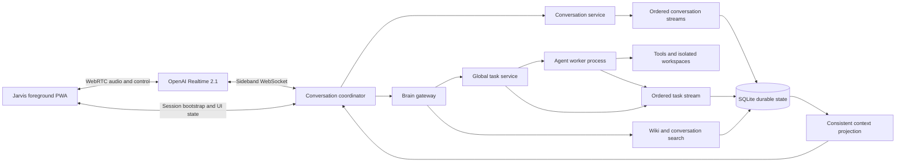

# Jarvis Target Architecture

## Status and purpose

This document records the agreed high-level end state for Jarvis. It is the normative architectural direction, not an implementation plan. The implemented prototype remains documented in [JARVIS_VOICE_POC.md](JARVIS_VOICE_POC.md), [JARVIS_EVOLUTION_ARCHITECTURE.md](JARVIS_EVOLUTION_ARCHITECTURE.md) explains how the prototype should evolve, and [JARVIS_IMPLEMENTATION_PLAN.md](JARVIS_IMPLEMENTATION_PLAN.md) is the approved phased execution contract.

Jarvis is a conversational interface to AI Cockpit. AI Cockpit remains the brain and durable backend: it owns conversations, tasks, tools, knowledge, workspaces, and long-running execution. The voice layer owns natural realtime interaction and presentation, but it does not become a second autonomous agent runtime.

## Architectural principles

- **One brain, multiple modalities.** Voice and text are modalities of the same conversation model. They share history, tasks, Wiki knowledge, and outcomes.
- **A thin conversational shell.** The realtime model handles turn-taking, small talk, acknowledgements, clarification, stable general knowledge, and natural phrasing. Personal facts, current information, tools, mutations, and substantial work are delegated to the AI Cockpit brain.
- **Delegation is asynchronous.** The shell acknowledges delegated work immediately. Brain answers, questions, progress, and results return later through durable task events instead of holding the voice turn open.
- **Durable state stays local.** AI Cockpit and SQLite remain the durable source for conversations, task state, knowledge, leases, and delivery records. A hosted realtime session is temporary presentation state.
- **Global tasks, isolated execution.** Tasks are first-class objects rather than children of a voice conversation. Each execution gets an isolated environment, and shared mutable resources have one writer at a time.
- **Conversation history reflects reality.** The durable timeline records what the user communicated and what Jarvis actually communicated. It does not pretend that an interrupted, unheard speech tail was delivered.
- **Domain ordering is sufficient.** Conversation and task activity are strictly ordered within their own domains. Causal links connect them; the system does not invent a total ordering across unrelated domains.
- **Operational events do not flood the dialogue.** Detailed task events remain available to the brain and task UI. Only acknowledgements, questions, important updates, and presented results enter the conversational timeline.
- **Provider boundaries remain replaceable.** OpenAI Realtime is the first voice provider, accessed through an internal session adapter rather than spread through task and conversation code.

## Target topology

The foreground PWA connects directly to OpenAI Realtime over WebRTC. The FastAPI conversation coordinator connects to the same provider session through a server-side sideband channel, allowing it to update session context, observe the interaction, and answer the shell's restricted tool calls. OpenAI documents this two-connection pattern in its [server-side controls guide](https://developers.openai.com/api/docs/guides/realtime-server-controls).

AI Cockpit remains one modular codebase and one local data boundary, but task execution moves to a separate worker process. This isolates live voice coordination from long-running or resource-heavy agent work without creating a separate Jarvis backend.

## Subsystem boundaries

### Jarvis voice client

The voice client owns microphone access, WebRTC media, the foreground wake/follow-up experience, visible transcript and task surfaces, and immediate output muting on barge-in. AI Cockpit proxies SDP setup through the provider's unified WebRTC call interface; the browser receives only the internal session identity and SDP answer, never the OpenAI API key or provider call ID.

After an idle period, a lightweight local wake detector opens the active conversation. Follow-up turns remain open until the interaction becomes idle again. Wake detection remains separate from general turn detection so its implementation can evolve without changing the brain contract.

Jarvis never speaks over or interrupts the user. The user may interrupt Jarvis at any time. A future ambient mode may surface information at a natural silence, but it retains the same non-interruption rule.

### Conversation coordinator

The coordinator owns the live Realtime session, current Jarvis daily log, context hydration, floor state, speech-delivery state, proactive-update candidates, and the shell-to-brain tool bridge. It is the only module that translates between provider events and durable AI Cockpit concepts.

Only one voice session is active for the personal v1. A newly authenticated foreground session supersedes a stale session. Provider session loss does not lose durable conversation or task state.

The coordinator exposes a provider-neutral `VoiceSessionAdapter`. OpenAI-specific WebRTC and sideband events stop at this boundary so another realtime provider or transport can be evaluated later without changing conversation, task, or Wiki ownership.

### Conversation and context service

Standard chats and Jarvis daily logs share one modality-neutral conversation, message, event, title, search, and transcript-rendering foundation. Their product rules remain distinct through conversation_kind: standard chats stay open-ended and support Agent/Council execution, branches, resend, and inline tools; Jarvis daily logs use the thin shell and become read-only when closed. Neither kind can be converted into the other.

Exactly one non-empty Jarvis log is current. The operational day changes at 04:00 Europe/Amsterdam, calculated as the local timestamp minus four hours. An active exchange crossing that boundary is not split; the next accepted Jarvis activation after it becomes idle closes the old log and creates a new sequence-1 log. An explicit fresh-start action can close the current log and create sequence 2 or later within the same operational day. Active tasks remain global and may surface results in a later daily log while retaining links to their origin.

Jarvis logs appear in the main conversation history as soon as their first durable turn is accepted. The current entry opens the live /jarvis workspace and carries Live or Current Jarvis state. Closed logs remain visible with Jarvis/date metadata and use the shared transcript renderer without composer, branching, resend, or tools. Closure remains independent from user-controlled hidden archival.

Older conversations are not loaded wholesale into each Realtime session. Initial historical lookup provides recent browsing plus exact or substring search through the brain. Full-text ranking, embeddings, and semantic retrieval are deferred until normal use demonstrates a need.

The live shell receives a compact context projection containing:

- recent unified dialogue;
- the assistant speech the user probably heard, including interruption markers;
- active task summaries and pending questions;
- important undelivered updates;
- selected approved Wiki or past-conversation facts supplied by the brain;
- independent conversation and task cursors describing the included snapshot.

### Brain gateway

The brain gateway is the only path from the conversational shell to AI Cockpit reasoning and tools. The shell may directly handle casual conversation, acknowledgements, clarification, natural phrasing, and stable general knowledge. It delegates personal or workspace facts, current or changing information, tool use, actions, mutations, and substantial work.

Every delegation is asynchronous:

1. The shell acknowledges the request naturally.
2. Dispatch accepts the request with an idempotency key and returns an accepted request or task identifier.
3. The brain performs the work outside the live voice turn.
4. Structured answers, statuses, questions, and results arrive as durable task-domain events.
5. The shell presents the relevant facts naturally when asked or when the update policy selects a safe moment.

The shell sees a deliberately small capability surface conceptually equivalent to dispatching work, inspecting a task snapshot, answering a pending task question, and cancelling a task. The brain returns structured facts, exact values, source identifiers, importance, and optional presentation hints; the shell owns the final conversational wording.

### Global task service and worker

A task exists independently of any conversation. It links to its originating standard conversation or Jarvis daily log and turn, but voice, text chat, and the task UI all inspect the same task. A run becomes an execution attempt belonging to a task rather than the task itself.

One separate SQLite-backed worker initially claims and executes one task at a time using the existing AI Cockpit agent runtime and tools. The single-worker limit keeps initial recovery and contention behavior simple; the task and lease contracts must permit later concurrency without changing task identity.

Each task receives an isolated task environment. Every shared mutable target has a typed exclusive-writer lease identified by resource type and stable resource identity, covering generated apps, repositories, named workspaces, Wiki targets, and comparable resources. If execution discovers another mutable target, it pauses, releases its current leases, expands its declared target set, requeues, and reacquires the full set rather than acquiring leases piecemeal.

An API restart does not interrupt work owned by the separate worker. Worker or PC loss is detected by the next worker takeover and marks unfinished work `interrupted`. Jarvis does not automatically resume or retry it. The durable trace remains inspectable and the user may explicitly retry it as a new attempt under the same task.

### Wiki and memory

The current reviewed-memory workflow becomes the first version of the Jarvis Wiki boundary. The brain may read approved knowledge. Every new memory or Wiki change remains a proposal requiring review while proposal quality is evaluated; automatic durable memory writes are outside v1.

Every proposed or approved item retains provenance to its source conversation, turn, task, or external source. Conversation search and Wiki search are brain capabilities, not direct Realtime-shell tools.

### Separate ordered domain streams

The conversation and task views are not independent sources of truth. They are projections of durable domain state, each with the ordering that domain needs:

- each conversation has a monotonically ordered conversation stream for user turns, assistant delivery, and presentation events;
- the task domain has a monotonically ordered task stream for task state, execution attempts, questions, progress, results, cancellation, and interruption;
- Wiki state remains provenance-linked but does not need to participate in live cross-domain ordering.

Cross-domain relationships use explicit causal identifiers such as `origin_turn_id`, `task_id`, `result_event_id`, and `presented_in_turn_id`. A result completing while the user is speaking is therefore not a race that requires a global clock. The meaningful facts are that the result came from a particular turn, whether it is still pending, and whether it was later presented and heard.

The coordinator reads both views from one consistent SQLite snapshot and records the independent cursors used. New committed activity can then be replayed from either cursor. No total ordering between unrelated conversation, task, lease, and Wiki activity is required, and the application is not required to be fully event-sourced. Pragmatic current-state tables remain alongside append-only domain events.

## Interruption and audible-history semantics

OpenAI Realtime 2.1 is the default voice model with low reasoning effort. Realtime 2.1 Mini remains a later configuration and evaluation option; Realtime 1.5 is outside the implementation and test plan. The selected model supports speech-to-speech interaction, tools, configurable reasoning, and improved noise, silence, and interruption behavior described in the [official model documentation](https://developers.openai.com/api/docs/models/gpt-realtime-2.1).

Semantic VAD is the target turn detector during an active conversation, initially biased toward allowing the user to finish rather than responding at the first pause. OpenAI exposes semantic VAD and eagerness controls in its [VAD guide](https://developers.openai.com/api/docs/guides/realtime-vad). It is not used as the wake-word detector.

When the user starts speaking, output audio is muted immediately and the current response is cancelled or truncated. With WebRTC, OpenAI handles truncating unplayed audio in provider conversation context, but it does not return the exact transcript prefix that reached the listener. AI Cockpit therefore records only the generated transcript, a best-effort heard prefix, a simple completed/interrupted/unheard state, and links to the source task or result. A small boundary error is acceptable; cutoff confidence scores and precision-heavy playback models are explicitly unnecessary for v1.

This approach follows the behavior described in OpenAI's [Realtime conversation guide](https://developers.openai.com/api/docs/guides/realtime-conversations). Natural continuation uses the heard prefix, the user's interruption, and the original factual intent. It does not mechanically resume at the next token. The full structured task result remains linked separately, allowing the shell to regenerate an appropriate continuation without losing facts that were in an unheard tail.

Important facts from an interrupted task update remain pending until naturally delivered, explicitly dismissed, or no longer relevant. Topic changes discard ordinary unheard speech tails. A request to continue produces a fresh continuation from a natural boundary without repeating the heard portion.

## Proactive updates and availability

Candidates for proactive presentation are updates the user requested, important milestones, completions, failures or interruptions, and questions that block a task. Detailed progress remains visible in the task surface and available on request.

At a safe conversational boundary, the same Realtime model makes an out-of-band text-only judgement to present the candidate now, fold it into the next reply, or defer it. The policy remains behind a replaceable `UpdateTimingPolicy` boundary so Realtime 2.1 Mini or the brain can be evaluated later if normal use shows the judgement is unreliable.

Deterministic constraints surround that judgement: Jarvis never speaks over the user, repeated updates are coalesced, and a result is never presented twice. Presentation and heard state are written back to the appropriate domain streams through causal links.

The first target remains one foreground PWA on one device with the AI Cockpit PC running. If the PC is off, voice is unavailable. If hosted Realtime voice fails while AI Cockpit remains available, the product falls back to text interaction; there is no v1 local realtime voice fallback. Raw audio is not retained. Web Push may alert the user while the PWA is not visible and resolves to the same durable task.

LiveKit, multiple simultaneous voice devices, a local speech-to-speech fallback, an offline brain, and a voice interface that interrupts people are outside v1. The internal session and brain boundaries should allow future ambient, non-interrupting endpoints without changing durable ownership.

## Personal-project security posture

The system remains single-user and local-first. Existing session authentication, backend-only provider secrets, loopback service binding, durable audit records, tool workspace boundaries, API-key safety, idempotency, cancellation, and resource leases are sufficient for this personal-project phase.

Multi-user roles, enterprise policy, advanced tenancy controls, and approval gates for ordinary agent actions are not required. Filesystem boundaries and leases remain correctness and data-protection mechanisms even within this reduced security scope.

## Migration and verification posture

The target will be reached by refactoring AI Cockpit in place. This is neither a clean rewrite nor a parallel feature-flagged voice architecture. Temporary breakage of the POC voice path is acceptable while shared boundaries are reshaped, but the POC documentation and evidence remain as historical records.

Verification is initially mostly human. A coded conversation lab should make scenarios easy to repeat and should be able to inject simulated commands, provider events, and task updates. Core scenarios cover wake and follow-up, long pauses, user barge-in, topic changes, natural continuation, task updates and questions, reconnect, duplicate events, the 04:00 operational-day rollover, and explicit same-day fresh starts. Automated tests protect deterministic backend and frontend behavior such as stream ordering, idempotency, worker claims, leases, cancellation, interruption, lifecycle, presentation, and context projection.

Latency and provider cost are recorded from the beginning but are not initial acceptance gates. Acoustic timing and conversational feel are evaluated manually.

## Implementation handoff

The contracts, phase order, APIs, deterministic checkpoints, manual acceptance scenarios, and multi-session handoff protocol are now defined in [JARVIS_IMPLEMENTATION_PLAN.md](JARVIS_IMPLEMENTATION_PLAN.md). [JARVIS_IMPLEMENTATION_LEDGER.md](JARVIS_IMPLEMENTATION_LEDGER.md) records the current phase and verification evidence.

Remaining research is implementation-focused: tune the local wake detector, calibrate the heard-prefix estimate, validate SQLite behavior with the separate worker, exercise Realtime reconnect and interruption behavior, and evaluate the model-based update-timing policy. Each item has a bounded phase and fallback in the plan; none reopens the high-level ownership decisions above.
