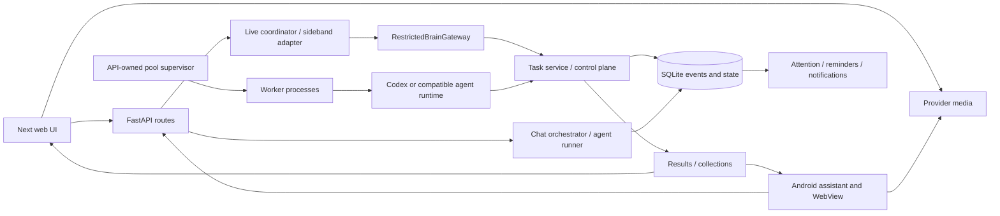

# Current architecture and reading map

Audit baseline: `0ab419d74d1595cfc9f3f803e9c069ae8d077f9a`, 2026-10-29. This is a navigation aid derived from the audited source, not a replacement specification.

## Start here

Read root `AGENTS.md` for development policy and `README.md` for setup. Then read `backend/app/main.py` and `backend/app/worker.py` to understand process ownership. Use the feature paths below rather than reading milestone reports in chronological order. Existing `docs/ARCHITECTURE.md` is a useful detailed reference, but its current-state and historical claims need reconciliation (see onboarding review).

Media is direct client/provider audio; backend sideband owns application actions. SQLite is durable authority. In-process commit signals only accelerate reads; periodic reads and cursors recover missed signals and other-process writes. A disconnected view must not become execution cancellation.

## Concepts and authorities

- **Conversation / branch / conversational run:** durable transcript, event stream, artifacts and interactive execution. `conversation_store.py` provides persistence; `chat_orchestrator.py` prepares turns, `agent_runner.py` executes, `run_supervisor.py` owns in-process tasks, and `run_lifecycle.py` handles cancellation transitions.
- **Task:** long-lived user goal. **Turn:** an ordered request/reply. **Execution run:** the outcome of one admitted request or follow-up. **Attempt:** a worker execution under claim/fencing authority. These identities are intentionally distinct: a late attempt must not mutate a later run. Read `models/tasks.py`, `task_service.py`, `worker_coordinator.py`, and matching tests together.
- **Workflow:** pinned procedure and allowed capabilities, not a second task lifecycle. `task_workflows.py`, `task_worker.py`, `task_capabilities.py`, `jarvis_tasks/task_mcp.py` are relevant entrypoints; check the symbol index for exact declarations.
- **Result:** stable public identity with authenticated access and revisioned content. `task_result_types.py` owns supported schemas, `task_result_contract.py` binds admission to an output request, and `task_results.py` owns publication/projection. `api/results.py` serves snapshots/actions/events; `result_static.py` serves the companion shell.
- **Live session / generation / activation:** voice transport and its ownership identities; not task execution identity. `jarvis_coordinator.py`, `openai_live_adapter.py`, `jarvis_brain.py`, and client policies coordinate these.
- **Attention / delivery:** whether an item needs the user's attention is separate from attempted speech, transcript persistence and notification delivery. Preserve those distinctions when extracting presentation code.
- **Knowledge:** DB-backed proposals and reviewed, file-backed publications. `knowledge_memory.py` publishes/removes files, `memory_review_store.py` forwards to `conversation_store.py`, and `brain_retrieval.py` reads published knowledge. Multiple route families currently mutate this lifecycle; see finding X01.

## Follow a feature

### Ordinary chat and generated apps

Web chat composes conversation hooks in `frontend/lib/hooks.ts`; `api.ts` transports requests. Backend `api/chat.py` delegates to `chat_orchestrator.py`, which uses settings, prompt construction, provider access and the durable runner. Council collects model responses and synthesizes them. Streaming is presentation over durable execution, not its lifetime owner.

Generated apps have a separate runtime from maintained typed results. `app_registry.py` owns app records, contracts, write roots and leases; agent tools bind app context to a run. The app catalog presents both families, but that does not justify merging execution or access policy. Preserve lease/write-root tests when simplifying it.

### JARVIS typed/voice request to task result

`api/jarvis.py` and the coordinator own daily logs and session interactions. Live tool actions pass through `RestrictedBrainGateway` in `jarvis_brain.py`, which checks allowed capabilities, admission identity and context before delegating to task/reminder services. `task_service.py` admits turns/runs and controls their lifecycle. The pool/worker coordinator claims work; execution sinks carry task/run/attempt/claim identity back to lifecycle services. Result publication is fenced by producing run and expected revision. Attention and delivery consume durable outcomes.

For cancel/retry/follow-up, read `api/tasks.py` -> `task_service.py` -> `worker_coordinator.py`/`task_worker.py` -> execution sink. Cancellation request and confirmed stopped writer are different states. Restart recovery and uncertain effects are long-term contracts, not obsolete compatibility behavior.

### Browser and Android voice

Browser wake capture/runtime/engine feed activation audio into `jarvis-live.ts`; `jarvis-live-state.ts` and transcript/feed helpers reconcile provisional and durable state. The JARVIS page currently ties these owners together and also interprets raw provider events.

Android packages already separate assistant, audio, Live, wake, web, notifications, data and updates. `JarvisAudioService` owns native audio controls; pure `AudioControlState` policy is a good entrypoint. `LiveController` negotiates media; `PhoneCaptureCoordinator` and screen privacy classes own capture constraints. `NativeVoiceBridge` restricts WebView operations to the paired origin/main frame. Closing a web view must not stop native Live audio. Use `docs/jarvis-tasks/11-android-audio-controls.md` for a focused path through this behavior.

### Settings and knowledge

Chat settings are routed through `api/chat.py` and `chat_settings.py`; JARVIS preferences use their own service and routes. Environment configuration is a third, distinct input. Locate the owning settings domain before adding a new field.

Knowledge review routes exist under conversations, knowledge and memory. Trace file publication as well as DB status. Retrieval reads the files: changing a DB flag alone does not withdraw approved content.

## How to choose verification

Use [verification.md](verification.md) for executed gates and commands. Locate focused tests by the owning service/policy name. Test fixtures isolate DB/workspaces and exclude the personal environment. Frontend reducers and Android pure policies are cheap local seams; Live provider and device acceptance are separate gates. Historical acceptance reports document their original candidates and cannot certify this audit candidate.

The coverage ledger and symbol/import indexes are evidence aids. A structural index is not a claim that every function was semantically reviewed.
